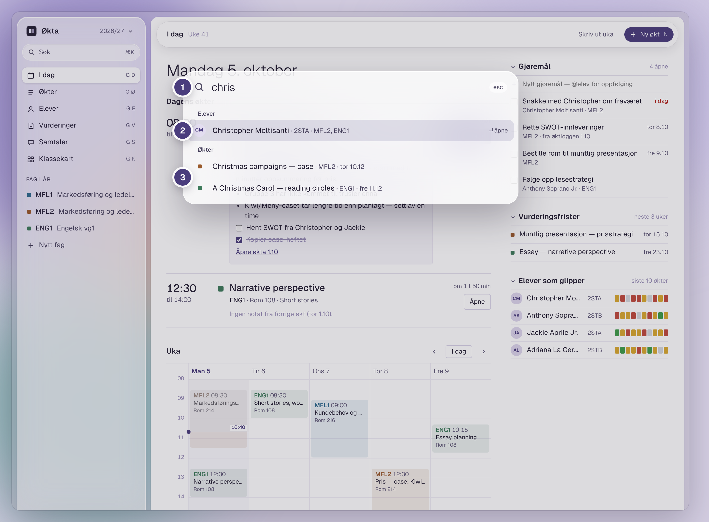
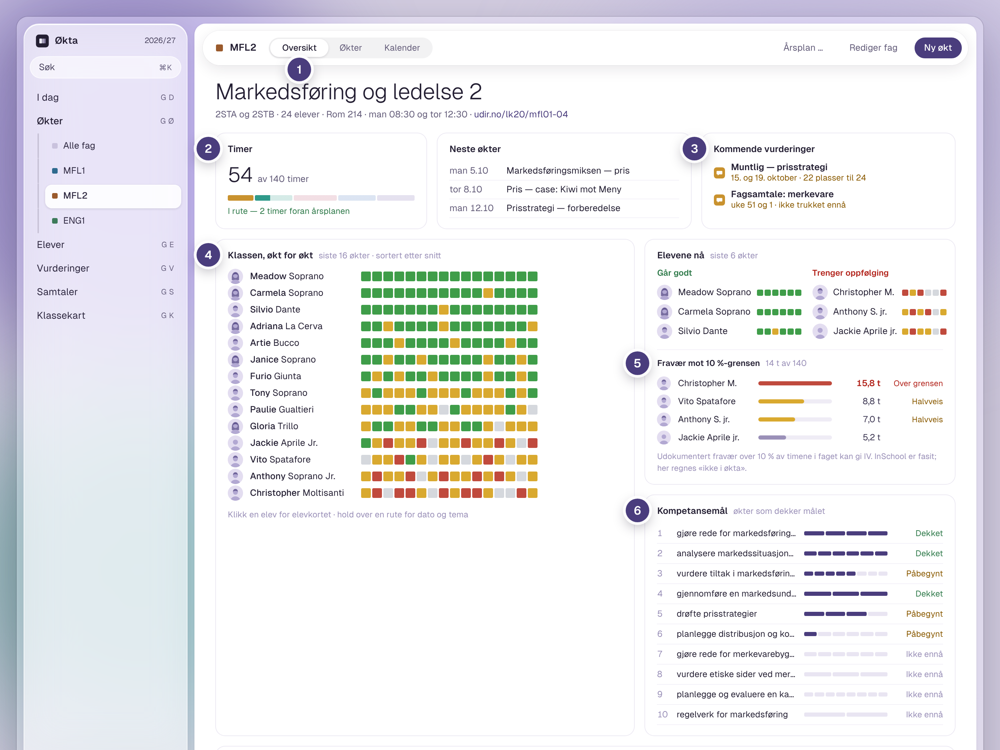
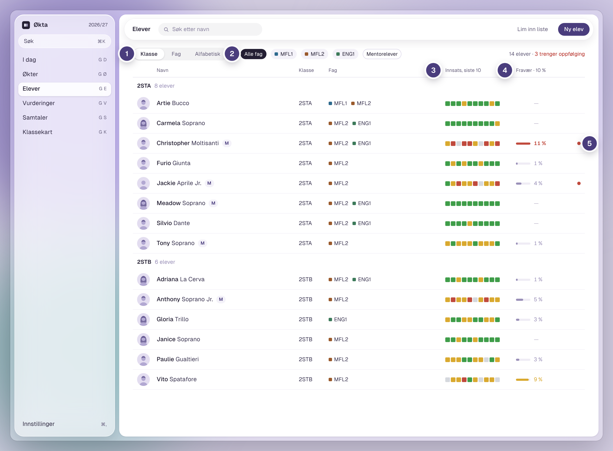
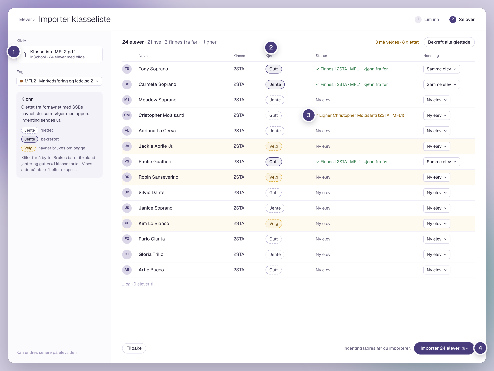
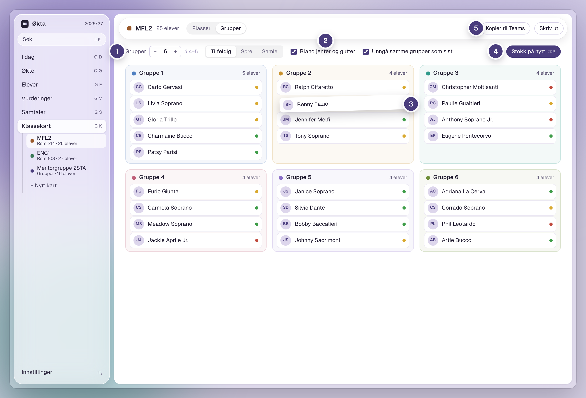
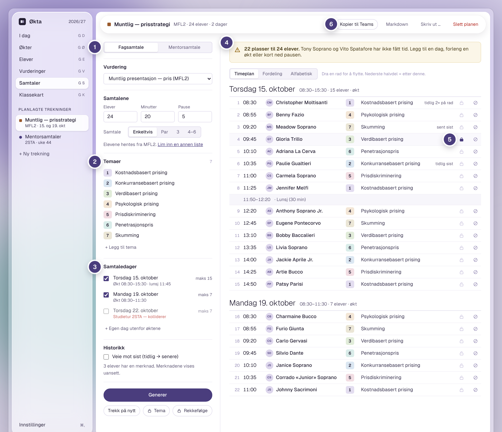
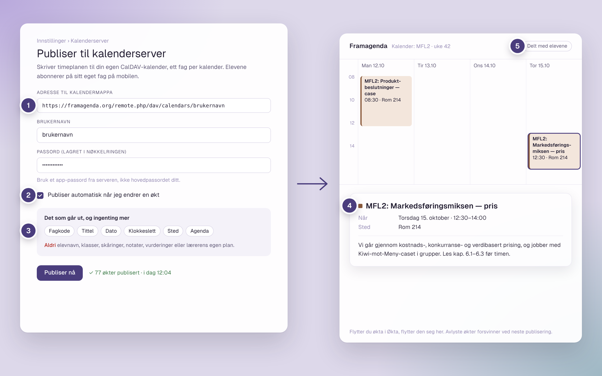

<p align="center">
  
</p>

<h1 align="center">Økta</h1>

<p align="center">
  Planlegg skoleåret, skår elevene underveis og se hvordan det går med dem over tid.<br>
  En Mac-app for lærere. Alt ligger på din egen maskin.
</p>

<p align="center">
  <a href="https://github.com/fbedsvaag/okta/releases/latest"><b>Last ned siste versjon</b></a>
  &nbsp;·&nbsp; macOS 13 eller nyere &nbsp;·&nbsp; Apple-brikke og Intel
</p>

<p align="center">
  <a href="#i-dag">I dag</a> ·
  <a href="#søk">Søk</a> ·
  <a href="#fagoversikten">Fag</a> ·
  <a href="#elevoversikten">Elever</a> ·
  <a href="#elevkortet">Elevkort</a> ·
  <a href="#importer-klasselista">Import</a> ·
  <a href="#klassekart">Klassekart</a> ·
  <a href="#grupper">Grupper</a> ·
  <a href="#samtaletrekkeren">Samtaler</a> ·
  <a href="#årsplanen-som-pdf">PDF</a> ·
  <a href="#timeplanen-i-kalenderen-til-elevene">Kalender</a>
</p>

---

## I dag


1. **Dagens økter.** Notatet fra forrige økt står klart, og du åpner skåringen med ett klikk.
2. **Gjøremål.** Det du skriver som `[ ]` i en økt, blir et gjøremål her. Fullførte går til loggen.
3. **Elever som glipper.** Elevene med svakest innsats de siste ti øktene, med trafikklyset for hver økt.
4. **Uka.** Kalender med nå-strek, så du ser hvor i dagen du er.

### Skåring med tastaturet


1. **Trafikklyset først i raden.** <kbd>3</kbd> grønn, <kbd>2</kbd> gul, <kbd>1</kbd> rød, <kbd>0</kbd> ikke i økta. Markøren går videre av seg selv.
2. **Fra forrige økt.** Det du skrev sist og planen for i dag, ved siden av klasselista.
3. **Øktlogg.** Skriv hvordan det gikk. `[ ]` blir et gjøremål på I dag.
4. **Tastene står nederst.** <kbd>N</kbd> gir notat på eleven, <kbd>Esc</kbd> lukker, og alt er lagret.

## Søk



1. **<kbd>⌘</kbd> <kbd>K</kbd> fra hvor som helst.** Skriv noen bokstaver av et navn eller et tema.
2. **Elever** med klasse og fag. <kbd>↵</kbd> åpner elevkortet.
3. **Økter** med fag og dato, gjennom hele skoleåret.

## Fagoversikten



1. **Oversikt, Økter og Kalender** for hvert fag.
2. **Timer.** Hvor mange av årstimene som er brukt, og om du ligger i rute med årsplanen.
3. **Kommende vurderinger**, med samtaledager og hvor mange plasser som er trukket.
4. **Klassen, økt for økt.** Hele klassens innsats i ett bilde, sortert etter snitt.
5. **Fravær mot 10 %-grensen**, regnet i timer mot fagets årstimetall.
6. **Kompetansemålene**, med hvor godt øktene så langt dekker hvert mål.

## Elevoversikten



1. **Grupper etter klasse eller fag**, eller vis alle alfabetisk.
2. **Filtrer på fag** eller mentorelever (merket M).
3. **Innsats de siste ti øktene**, rute for rute.
4. **Fravær** mot 10 %-grensen.
5. **Rød prikk** på elevene som trenger oppfølging.

## Elevkortet


1. **Innsats gjennom året.** Én rute per økt, fag for fag, fra august til juni.
2. **Vurderinger.** Skriftlige og muntlige, med karakter eller kommentar. Muntlige åpnes i Samtaler.
3. **Notater og møtelogg.** Alt fra øktene og samtalene på ett sted, med gjøremål og frister.
4. **Fravær i år**, per fag, i prosent, økter og timer.
5. **Kjønn gjettet fra fornavnet** ved import. Det bekreftes med ett klikk, og forlater aldri appen.

## Importer klasselista



1. **Les klasselista rett fra InSchool-PDF-en**, med navn, klasse og bilder. Eller lim inn en liste.
2. **Kjønn gjettes fra fornavnet** med SSBs navneliste, som følger med appen. Navn som brukes om begge, må du velge selv.
3. **Kjenner igjen elever** du har fra før, også når navnet er stavet litt annerledes.
4. **Ingenting lagres** før du trykker Importer.

## Klassekart


1. **Lås en elev** til en pult med et klikk. Dra for å bytte plass.
2. **Hold elever fra hverandre**, bland jenter og gutter, og unngå dem som har sittet sammen før.
3. **Ikke til stede i dag.** Dra eleven hit, så får hen ikke plass.
4. **Stokk på nytt.** De låste blir sittende.
5. **Del** som utskrift, PDF, bilde til Teams eller liste.

## Grupper



1. **Velg antall grupper**, og fordel tilfeldig, spredt på innsats eller med likt nivå sammen.
2. **Bland jenter og gutter**, og unngå de samme gruppene som sist.
3. **Dra en elev** til en annen gruppe.
4. **Stokk på nytt** til du er fornøyd.
5. **Kopier til Teams** eller skriv ut.

## Samtaletrekkeren



1. **Fagsamtaler eller mentorsamtaler**, enkeltvis, i par eller i grupper.
2. **Temaene** fordeles på elevene, så ikke alle får det samme.
3. **Samtaledagene** hentes fra øktene. Appen sier fra om noe kolliderer.
4. **Sier fra** når det er flere elever enn plasser.
5. **Lås** en elev til et tidspunkt, og trekk resten på nytt.
6. **Kopier til Teams**, som markdown eller utskrift.

## Årsplanen som PDF


1. **Timeregnskapet.** Hvor mye av årstimetallet øktene dekker, fordelt på temaene.
2. **Kompetansemålene** fra læreplanen, med lenke til Udir.
3. **Lekse og vurdering** for hver økt.
4. **Temaene** med uker, antall økter og hvilke mål de dekker.

Samme innhold kan også tas ut som Word, markdown og CSV.

## Timeplanen i kalenderen til elevene



Økta kan publisere timeplanen til din egen kalender, for eksempel **Framagenda** eller en annen CalDAV-server. Hvert fag får sin egen kalender, som elevene kan abonnere på fra mobilen. Endrer du en økt i Økta, oppdateres den i kalenderen.

1. **Adressen til kalendermappa** på serveren din. Passordet lagres i nøkkelringen på Macen.
2. **Publiser automatisk** når du endrer en økt, eller trykk Publiser nå.
3. **Bare seks felt går ut:** fagkode, tittel, dato, klokkeslett, sted og agenda. Aldri elevnavn, skåringer, notater eller vurderinger.
4. **Slik ser økta ut i kalenderen**, med agendaen du har skrevet til elevene.
5. **Del kalenderen** med elevene som en lenke.

Dette er det eneste Økta sender ut, og det er av til du slår det på.

---

## Installer

1. Last ned **Økta-x.x.x.dmg** fra [siste versjon](https://github.com/fbedsvaag/okta/releases/latest).
2. Åpne fila og dra **Økta** over på **Programmer**.
3. Første gang du åpner appen stopper macOS den, fordi den ikke er sendt gjennom Apples godkjenning. Gå til **Systeminnstillinger › Personvern og sikkerhet**, rull ned og trykk **Åpne likevel**. Det trengs bare én gang.

Ny versjon: dra den nye Økta til Programmer og velg **Erstatt**. Dataene dine blir liggende.

## Dataene dine

- Alt lagres lokalt på din Mac. Økta sender ingenting noe sted, med ett unntak du slår på selv: timeplanen til din egen kalender.
- Økta tar en sikkerhetskopi hver dag og beholder de siste 30.
- Elevbilder og kjønn vises bare i appen og blir aldri med i utskrift, eksport eller kalender.
- Slå på FileVault, og legg ikke arkivmappa i OneDrive eller iCloud når det er ekte elever i appen.

Dette er en testversjon. Avklar med skolen før du legger inn ekte elever.

## Utvikling

Tauri 2, React og SQLite.

```sh
npm install
npm run tauri dev        # kjør appen
npm test                 # testene
npm run tauri build -- --target universal-apple-darwin   # dmg for begge Mac-typer
```

`SPEC.md` beskriver hva appen skal gjøre, `DESIGN.md` hvordan den ser ut, `ARBEIDSLISTE.md` hva som står for tur og `STATUS.md` hvor den står nå. Tegningene i `docs/lerret/` er fasit for utseendet.

<sub>Skjermbildene er fra designet og viser oppdiktede elever.</sub>
