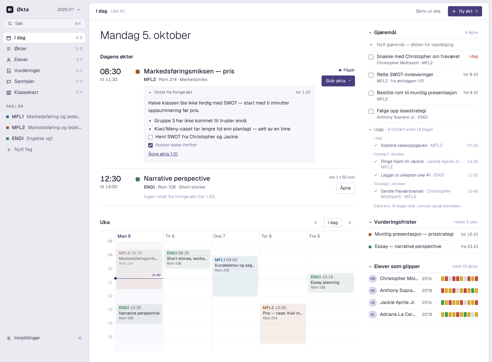
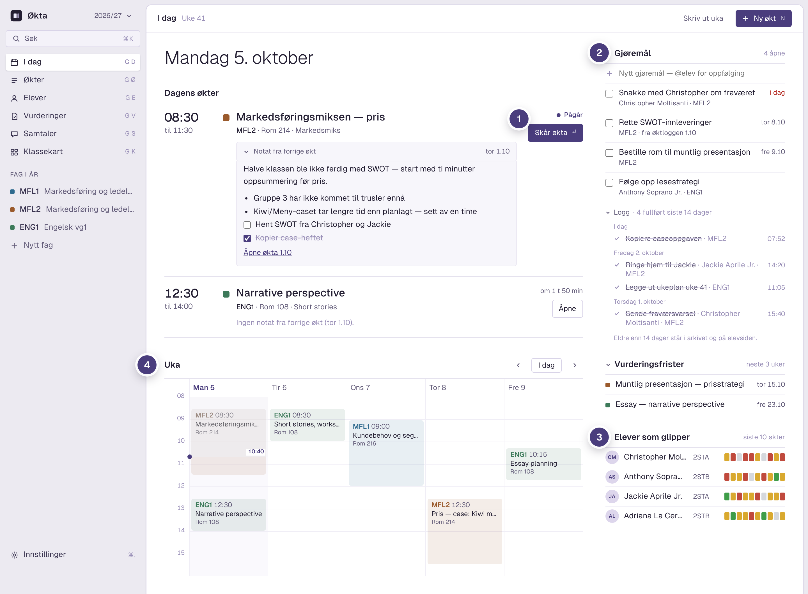
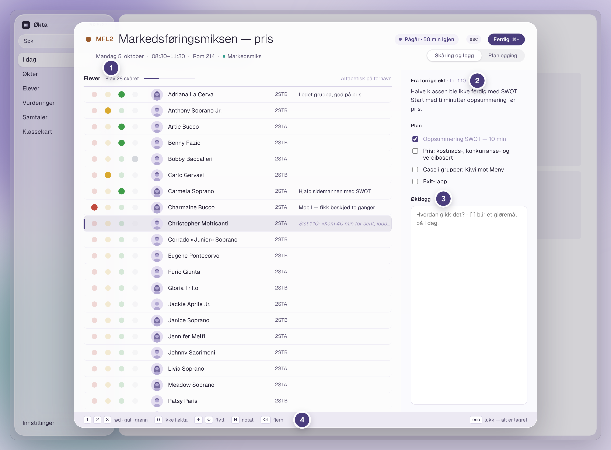
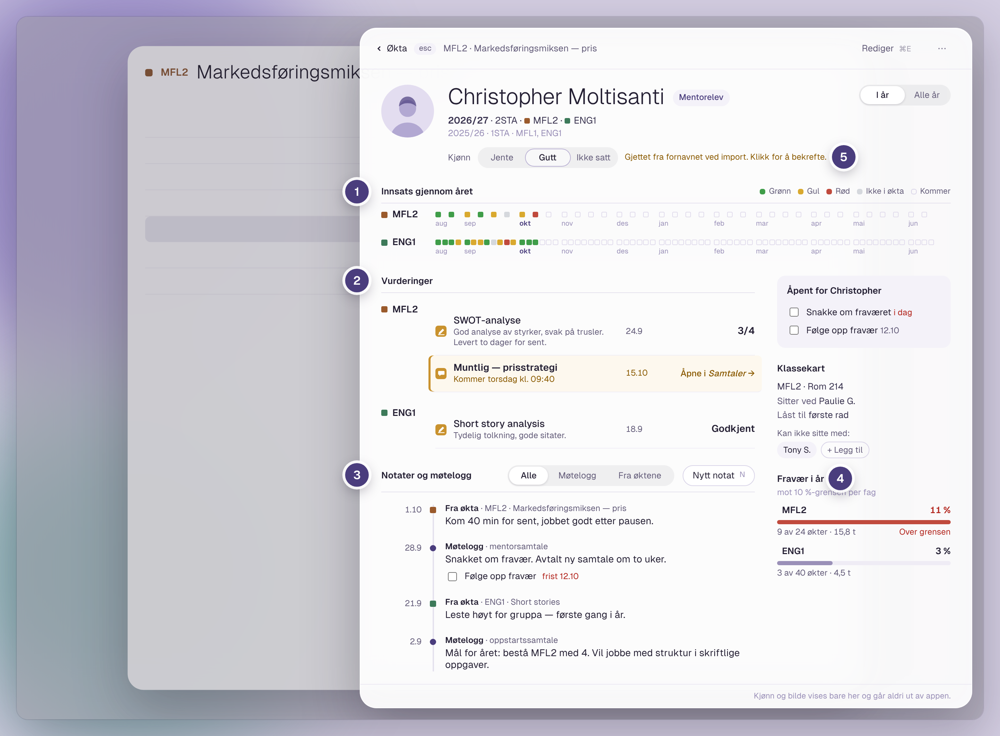
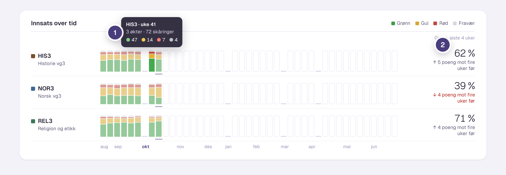
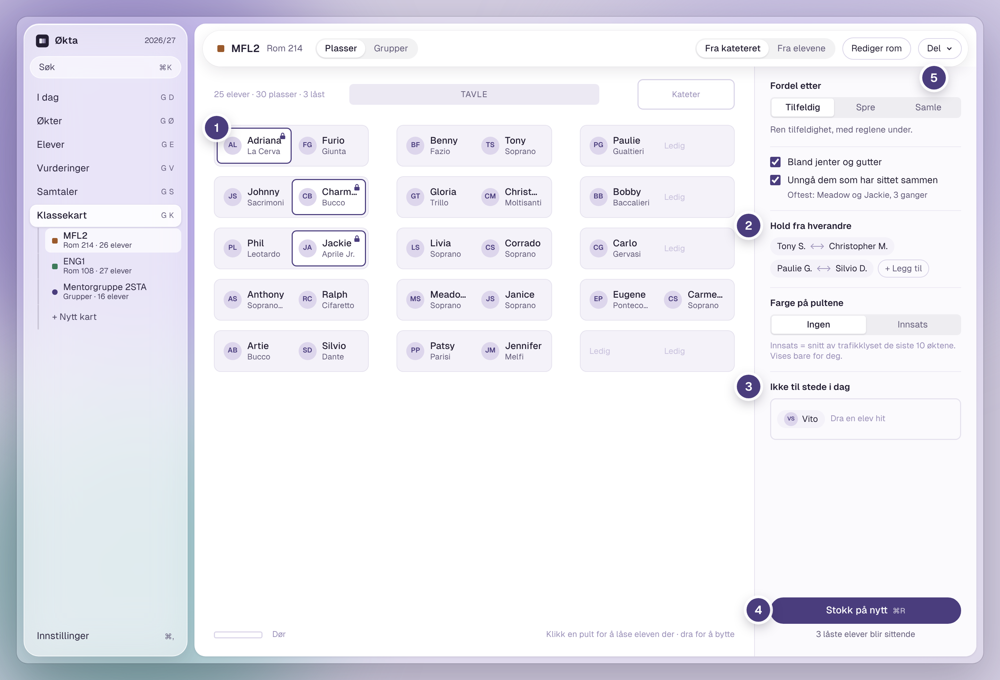
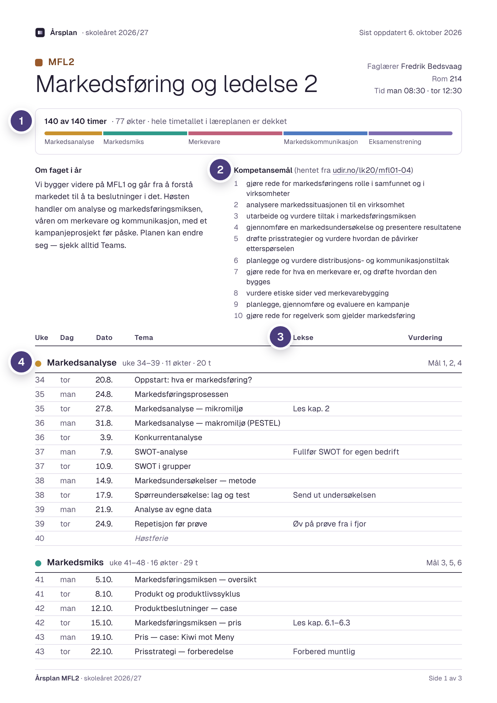

<p align="center">
  
</p>

<h1 align="center">Økta</h1>

<p align="center">
  Planlegg skoleåret, skår elevene underveis og se hvordan det går med dem over tid.<br>
  En Mac-app for lærere. Alt ligger på din egen maskin.
</p>

<p align="center">
  <a href="https://github.com/fbedsvaag/okta/releases/latest"><b>Last ned siste versjon</b></a>
  &nbsp;·&nbsp; macOS 13 eller nyere &nbsp;·&nbsp; Apple-brikke og Intel
</p>

---

## I dag



1. **Dagens økter.** Notatet fra forrige økt står klart, og du åpner skåringen med ett klikk.
2. **Gjøremål.** Det du skriver som `[ ]` i en økt, blir et gjøremål her. Fullførte går til loggen.
3. **Elever som glipper.** Elevene med svakest innsats de siste ti øktene, med trafikklyset for hver økt.
4. **Uka.** Kalender med nå-strek, så du ser hvor i dagen du er.

## Skåring med tastaturet



1. **Trafikklyset først i raden.** <kbd>3</kbd> grønn, <kbd>2</kbd> gul, <kbd>1</kbd> rød, <kbd>0</kbd> ikke i økta. Markøren går videre av seg selv.
2. **Fra forrige økt.** Det du skrev sist og planen for i dag, ved siden av klasselista.
3. **Øktlogg.** Skriv hvordan det gikk. `[ ]` blir et gjøremål på I dag.
4. **Tastene står nederst.** <kbd>N</kbd> gir notat på eleven, <kbd>Esc</kbd> lukker, og alt er lagret.

## Elevkortet



1. **Innsats gjennom året.** Én rute per økt, fag for fag, fra august til juni.
2. **Vurderinger.** Skriftlige og muntlige, med karakter eller kommentar. Muntlige åpnes i Samtaler.
3. **Notater og møtelogg.** Alt fra øktene og samtalene på ett sted, med gjøremål og frister.
4. **Fravær mot 10 %-grensen.** Regnet i timer mot fagets årstimetall, per fag.
5. **Kjønn gjettet fra fornavnet** ved import (SSBs navneliste). Det bekreftes med ett klikk, og forlater aldri appen.

## Innsats over tid



1. **Én søyle per uke** for hele skoleåret. Hold musa over for å se øktene og tallene.
2. **Andel grønn de siste fire ukene**, og endringen fra de fire ukene før.

## Klassekart



1. **Lås en elev** til en pult med et klikk. Dra for å bytte plass.
2. **Hold elever fra hverandre**, bland jenter og gutter, og unngå dem som har sittet sammen før.
3. **Ikke til stede i dag.** Dra eleven hit, så får hen ikke plass.
4. **Stokk på nytt.** De låste blir sittende.
5. **Del** som utskrift, PDF, bilde til Teams eller liste.

## Årsplanen som PDF



1. **Timeregnskapet.** Hvor mye av årstimetallet øktene dekker, fordelt på temaene.
2. **Kompetansemålene** fra læreplanen, med lenke til Udir.
5. Samme innhold kan også tas ut som Word, markdown og CSV.
3. **Lekse og vurdering** for hver økt.
4. **Temaene** med uker, antall økter og hvilke mål de dekker.

---

## Installer

1. Last ned **Økta-x.x.x.dmg** fra [siste versjon](https://github.com/fbedsvaag/okta/releases/latest).
2. Åpne fila og dra **Økta** over på **Programmer**.
3. Første gang du åpner appen stopper macOS den, fordi den ikke er sendt gjennom Apples godkjenning. Gå til **Systeminnstillinger › Personvern og sikkerhet**, rull ned og trykk **Åpne likevel**. Det trengs bare én gang.

Ny versjon: dra den nye Økta til Programmer og velg **Erstatt**. Dataene dine blir liggende.

## Dataene dine

- Alt lagres lokalt på din Mac. Økta sender ingenting noe sted, med ett unntak du slår på selv: timeplanen til din egen kalender.
- Økta tar en sikkerhetskopi hver dag og beholder de siste 30.
- Elevbilder og kjønn vises bare i appen og blir aldri med i utskrift, eksport eller kalender.
- Slå på FileVault, og legg ikke arkivmappa i OneDrive eller iCloud når det er ekte elever i appen.

Dette er en testversjon. Avklar med skolen før du legger inn ekte elever.

## Utvikling

Tauri 2, React og SQLite.

```sh
npm install
npm run tauri dev        # kjør appen
npm test                 # testene
npm run tauri build -- --target universal-apple-darwin   # dmg for begge Mac-typer
```

`SPEC.md` beskriver hva appen skal gjøre, `DESIGN.md` hvordan den ser ut, `ARBEIDSLISTE.md` hva som står for tur og `STATUS.md` hvor den står nå. Tegningene i `docs/lerret/` er fasit for utseendet.

<sub>Skjermbildene er fra designet og viser oppdiktede elever.</sub>
