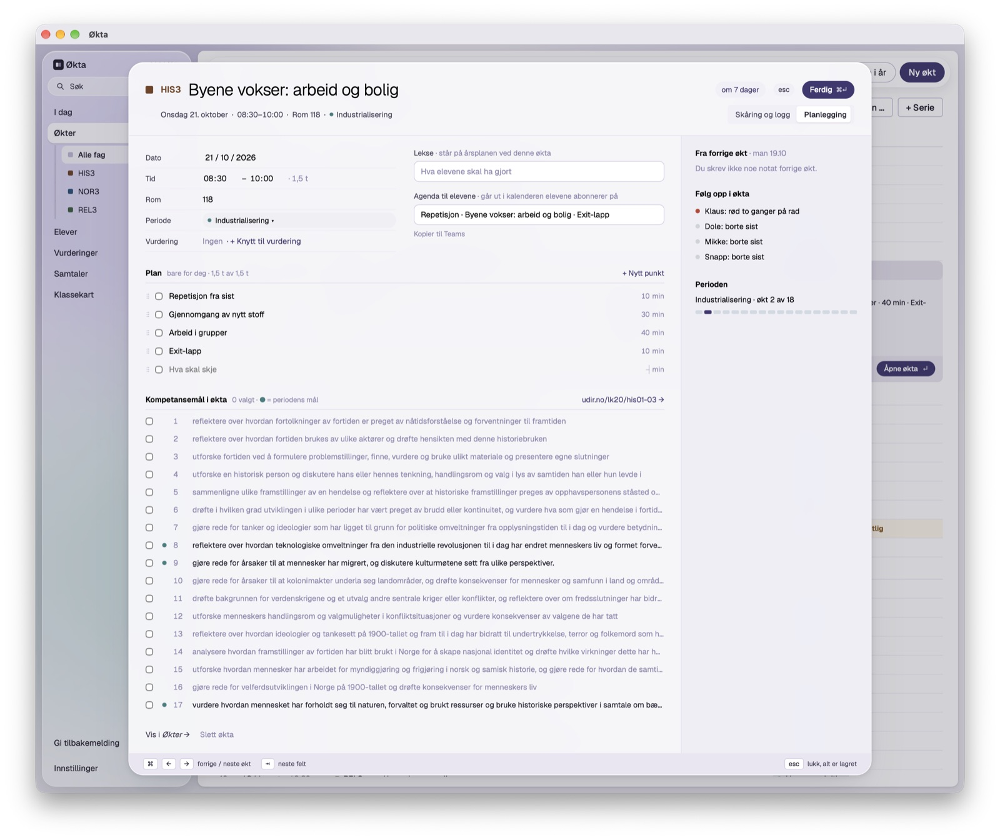

# Bestilling til lerretet: øktkortet, planlegging og live tidslinje

14.10.2026. Til designeren, før noe bygges. Lerretene å bygge videre på:
`docs/lerret/OktArk.dc.html`, `OktPlan.dc.html` og `OktSkar.dc.html`.
`DESIGN.md` beskriver appen slik den er bygget nå.

## Først: endret siden lerretene ble tegnet

Dette er bygget i appen, men finnes ikke i lerretet. Ta det med, så nye
tegninger ikke viser en eldre utgave.

- **Sidemenyen:** «Gi tilbakemelding» står over Innstillinger, i samme stil.
  Et klikk viser «Kopiert. Lim inn under «Versjon og skjerm».» i raden.
- **Verktøylinja:** får ikke knappene plass, toner høyre kant ut og en
  vinkelpil (⌄) kommer ytterst. Den bretter linja ut over flere rader
  (kapselen blir rundet rektangel), venstrejustert. Forsvinner når det er
  plass igjen.
- **I dag:** «Innsats over tid» nederst over hele bredden (lerretet
  `InnsatsTid`, forklaringen sier «Fravær»). «Elever som glipper» viser bare
  dem med minst to røde blant de fem siste øktene, og er tom («Ingen elever
  glipper nå») når ingen gjør det. Vurderingsfrister viser bare dem som ikke
  er ferdig ført.
- **Samtaletimeplanen, dra og slipp:** klokkeslettene står fast i sin
  kolonne, og bare elevene glir. Raden som dras er et hvitt kort med skygge
  og har sitt eget klokkeslett i aksentfarge, som ruller tegnvis som et
  telleverk til tida på plassen den er over. En nabo gjør plass når kortet
  dekker 30 % av den (240 ms, myk slutt), og kortet glir på plass ved slipp.
- **Windows:** samme utseende. Snarveiene vises som «Ctrl+K» i stedet for
  «⌘K», og «Som macOS» heter «Som Windows».

## Bakgrunn

Økta åpnes som et ark og har to moduser med en bryter øverst til høyre:
**Skåring og logg** og **Planlegging** (DESIGN §10). Planen er i dag en
sjekkliste med én tekstlinje og minutter per punkt, summen mot øktas
lengde («40 min av 1,5 t») og dra for å flytte. I skåringen står den samme
lista i høyre kolonne, med avkrysning.

Planen lagres som markdown i `okt.plan`: `- [ ] Gjennomgang av nytt stoff · 30 min`.
Det er med vilje: arkivet (§8) skrives som lesbare filer, og planen skal
kunne leses uten appen.

Slik ser planleggingen ut nå (dummydata):

To ting å merke seg i bildet:

- **Kompetansemålene tar mest plass.** Alle fagets mål (her 17 lange
  linjer) står utfoldet under planen, også når ingen er valgt. Planen, som
  er det læreren jobber med i denne modusen, drukner. Bør målene foldes
  sammen, eller bare vise de valgte og periodens?
- **Summen er lett å overse.** «1,5 t av 1,5 t» står i liten grå tekst i
  overskriften. Tidslinjen under kan erstatte den.

## Hva læreren vil

### 1. Planlegging: aktivitet, beskrivelse og tidsbruk

Hvert punkt i planen skal kunne ha:

- **Aktivitet**: kort tittel («Gjennomgang», «Gruppearbeid: kildekritikk»).
- **Beskrivelse**: noen linjer om hva som skal skje, hva elevene gjør, hva
  som må være klart. Valgfri, og lukket til den trengs.
- **Tidsbruk** i minutter.

Planen skal vise hvordan tida i økta brukes: en stolpe eller tidslinje over
hele øktas lengde der hver aktivitet er et felt med bredde etter
minuttene, så man ser med en gang om planen går opp. Går den over, skal
det synes uten alarm; går den under, er resten luft.

### 2. Live tidslinje når økta er åpen for skåring

Når økta pågår, skal tidslinjen vise hvor man er:

- en nå-markør som flytter seg gjennom økta,
- hvilken aktivitet som skulle pågått nå, og hvor langt man er i den,
- hvor mye tid som er igjen, i økta og i aktiviteten,
- at man ligger etter eller foran: er en aktivitet ikke krysset av når tida
  for den er ute, flytter resten av planen seg (eller viser at den er
  forskjøvet), så man ser hva som rekker.

Avkrysning av en aktivitet skjer i tidslinjen eller i lista, ett klikk.

## Spørsmål til tegningen

1. **Hvor står tidslinjen?** Øverst i arket under toppen, i høyre kolonne
   sammen med planen, eller som en tynn stripe over elevlista?
2. **Planleggingen:** er tidslinjen selve redigeringen (dra i kantene for å
   endre minuttene, dra feltene for å bytte rekkefølge), eller en forhåndsvisning
   over lista? Hvordan skrives beskrivelsen: under tittelen, eller i et felt
   som foldes ut?
3. **Farger på aktivitetene:** trafikklyset er det eneste mettede i appen
   (DESIGN §9). Holder fagfargen i svake toner, eller nøytrale felt med
   skiller?
4. **Forskyvning:** når man ligger etter, flytter de neste aktivitetene seg
   på tidslinjen, eller står planen fast med en markering av hvor man
   faktisk er?
5. **Før start og etter slutt:** hva viser tidslinjen når økta ikke har
   begynt («om 12 min»), og når den er ferdig?
6. **Uten plan:** hvordan ser kortet ut når ingen plan er skrevet? En tom
   tidslinje med «Legg til aktivitet», eller ingenting?
7. **Pauser:** skal en pause være en egen type aktivitet (tonet, uten
   avkrysning)?

## Rammer

- **Skåringen animeres aldri** (SPEC §13): tastetrykk, farge, neste elev på
  null millisekunder. Tidslinjen kan flytte seg rolig (for eksempel én gang
  i minuttet), men skal ikke trekke blikket fra elevlista mens man skårer.
- **Plan og beskrivelse er lærerens egne.** De går aldri ut: ikke i
  kalenderen, Teams-teksten eller årsplanen til elevene.
- **Lagringen må tåle markdown.** Beskrivelsen kan for eksempel lagres som
  innrykkede linjer under punktet. Formatet bestemmer vi når tegningen står;
  det skal fortsatt være lesbart i arkivet.
- Glass og bevegelse som ellers (DESIGN §7, §8). Med «Bevegelse: av» står
  alt stille og hopper rett til ny verdi.
- Norsk bokmål, ingen tankestrek i tekstene.
- Bredde: arket må fungere fra 1024 pt vindu og opp.
